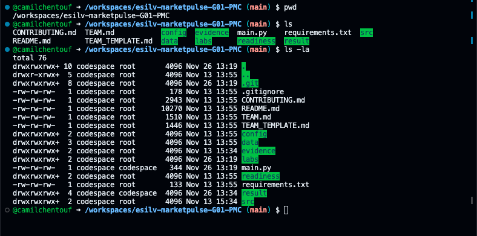
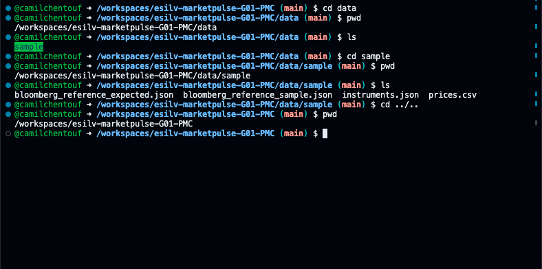
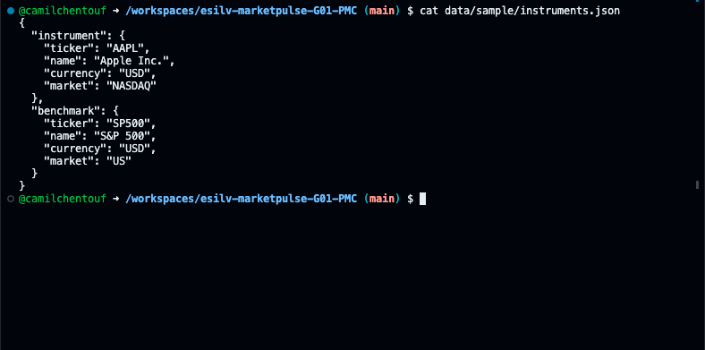
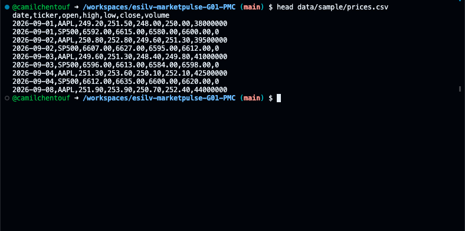
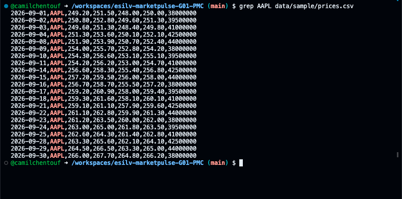
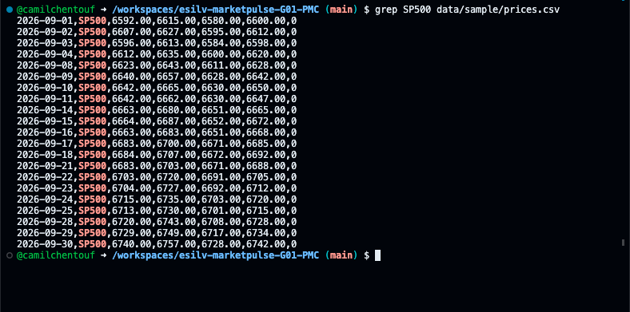
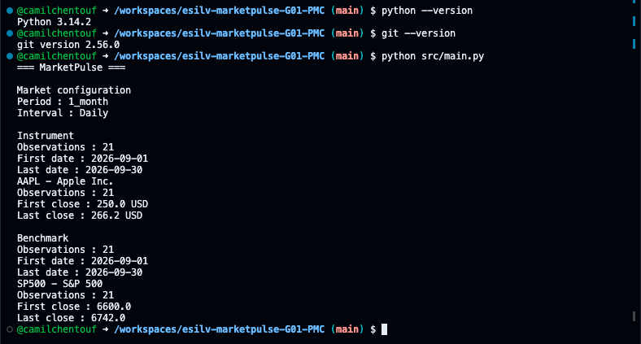

# TD01 – Réponses Partie 6

1. **Instrument** : AAPL (Apple Inc.), coté sur le NASDAQ, en USD.
2. **Benchmark** : SP500 (S&P 500), marché US, en USD.
3. **Noms et tickers** : dans `data/sample/instruments.json`, sous les clés `name` et `ticker` de chaque bloc (`instrument` et `benchmark`).

# Partie 7 – Composants

- Programme : `src/main.py`
- Métadonnées marché : `data/sample/instruments.json`
- Prix quotidiens : `data/sample/prices.csv`
- Instrument : AAPL (Apple Inc.)
- Benchmark : SP500 (S&P 500)
- Python 3.14.2 / Git 2.56.0
- Note : la sortie de `main.py` diffère de celle du TD01 car le programme a été enrichi lors des TD suivants ; les valeurs (266.2 USD, 6742.0, 21 observations) correspondent.

# Captures

## Partie 5 – Navigation Linux

## Partie 6 – Données

## Partie 7 – Environnement
