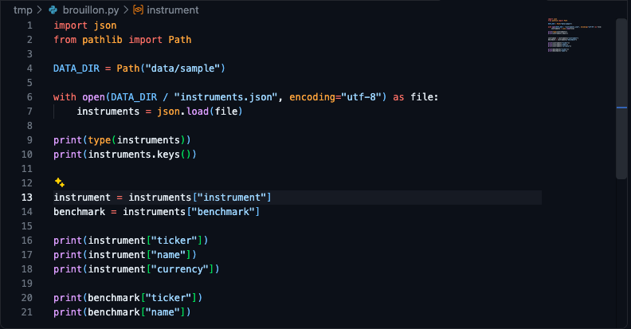
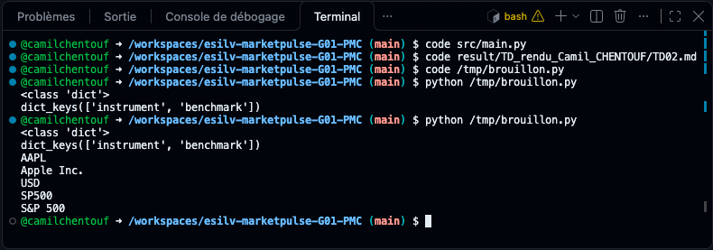
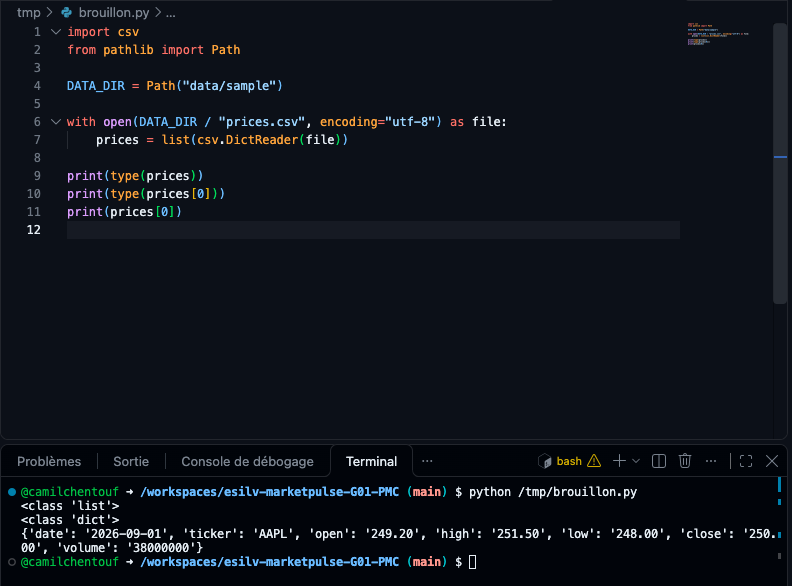
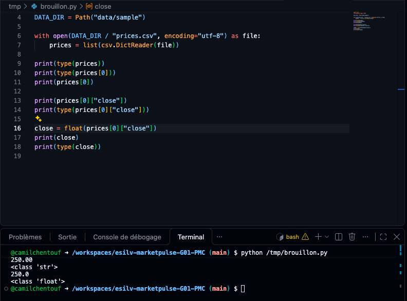
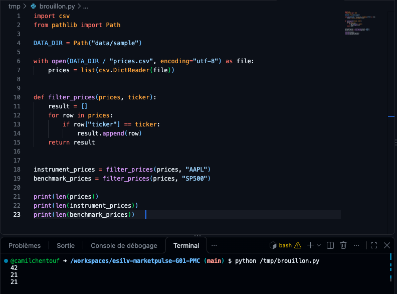
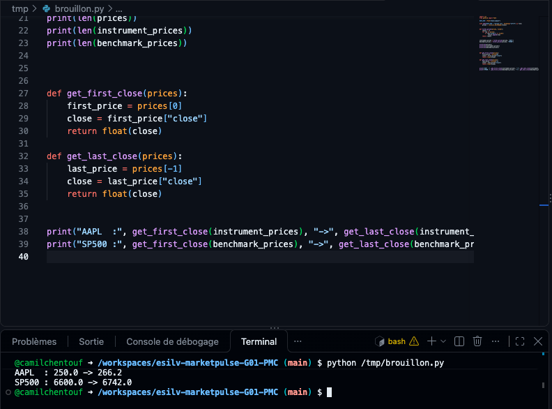
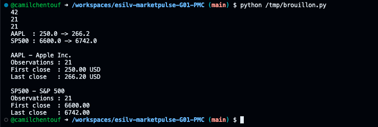
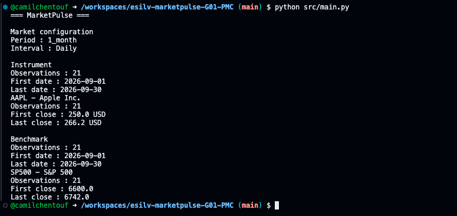

# TD02 – Python + CSV / JSON

## Partie 1 – Lecture du starter
1. Lecture du JSON : `load_instruments()` (via `json.load`)
2. Lecture du CSV : `load_prices()` (via `csv.DictReader`)
3. Sélection d'un ticker : `filter_prices()`
4. Coordination de l'exécution : `main()`
5. Fichiers d'entrée : `data/sample/` (variable `DATA_DIR`)

## Partie 2 – JSON et dictionnaires
- `instruments` : un dictionnaire (`dict`) avec deux clés, `instrument` et `benchmark`.
- `instrument` : un dictionnaire qui décrit l'instrument principal (AAPL, Apple Inc., USD).
- `benchmark` : un dictionnaire qui décrit le benchmark de comparaison (SP500, S&P 500).
- `json.load()` transforme le texte JSON en objets Python ; on accède à une valeur avec `dico["clé"]`.

## Partie 3 – CSV et listes de dictionnaires
- `csv.DictReader` renvoie les lignes du CSV sous forme de dictionnaires (clés = noms de colonnes) ; avec `list(...)` on obtient une liste de dictionnaires.
- `prices` est une `list`, `prices[0]` est un `dict`.
- Les valeurs lues dans un CSV sont du texte (`str`) : `'250.00'`. Il faut les convertir avec `float()` avant tout calcul, sinon les opérations se font sur du texte.

## Partie 4 – Filtrage
- `filter_prices(prices, ticker)` parcourt toutes les lignes (`for`), garde celles dont le ticker correspond (`if`) et les ajoute à une nouvelle liste (`append`) : boucle + condition + append = filtrage.
- Résultat : 42 lignes au total, 21 pour AAPL et 21 pour SP500.

## Partie 5 – Premier et dernier close
- `get_first_close(prices)` : prend `prices[0]`, lit `close`, convertit avec `float()`.
- `get_last_close(prices)` : même logique avec `prices[-1]` (dernier élément).
- AAPL : 250.0 → 266.2 ; SP500 : 6600.0 → 6742.0.

## Partie 6 – Fonction de résumé réutilisable
- `display_market_summary(asset, prices, show_currency=True)` affiche ticker, nom, nombre d'observations, premier et dernier close.
- La même fonction sert pour AAPL et SP500 : pas de code d'affichage dupliqué (même opération + données différentes = fonction réutilisable).
- `show_currency=False` pour le benchmark : un indice s'exprime en points, pas en devise.

## Partie 7 – main() lisible
- `main()` enchaîne : chargement des métadonnées et des prix, sélection instrument/benchmark, filtrage des deux séries, affichage de la configuration, puis des deux résumés.
- Toute la logique est déléguée à de petites fonctions (`load_*`, `filter_prices`, `get_*_close`, `display_market_summary`) : `main()` ne fait que coordonner.

## Partie 8 – Validation
- `python src/main.py` s'exécute sans erreur.
- AAPL : 21 observations, close 250.0 → 266.2 USD.
- SP500 : 21 observations, close 6600.0 → 6742.0.
- Petites différences de format (1 décimale au lieu de 2) acceptées par le TD. L'option 1 (première/dernière date) est également implémentée.

# Captures

## Partie 2 – JSON

## Partie 3 – CSV

## Partie 4 – Filtrage

## Partie 5 – Premier et dernier close

## Partie 6 – Résumé réutilisable
-6.png)
-6.png)

## Partie 8 – Validation

