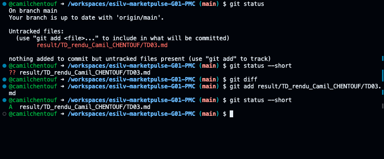
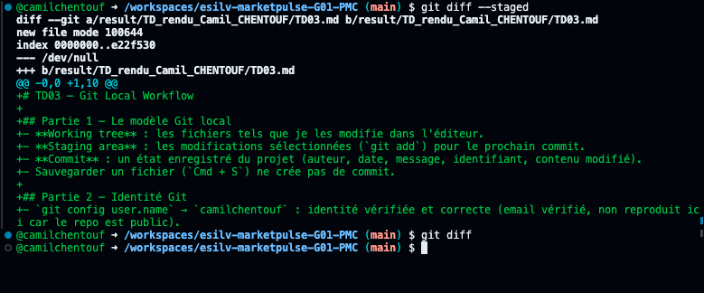
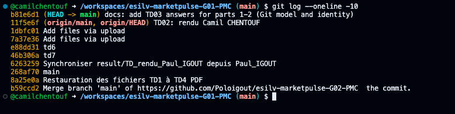
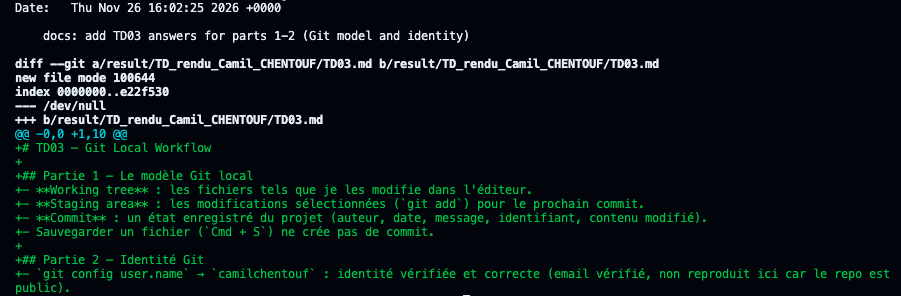
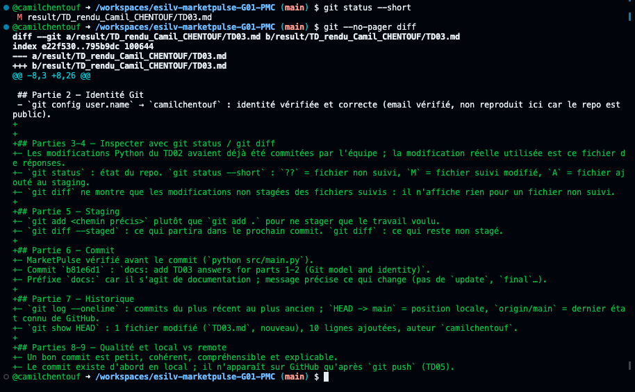
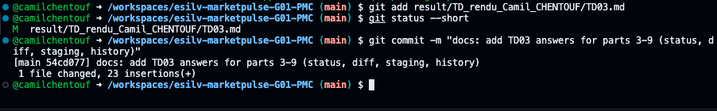
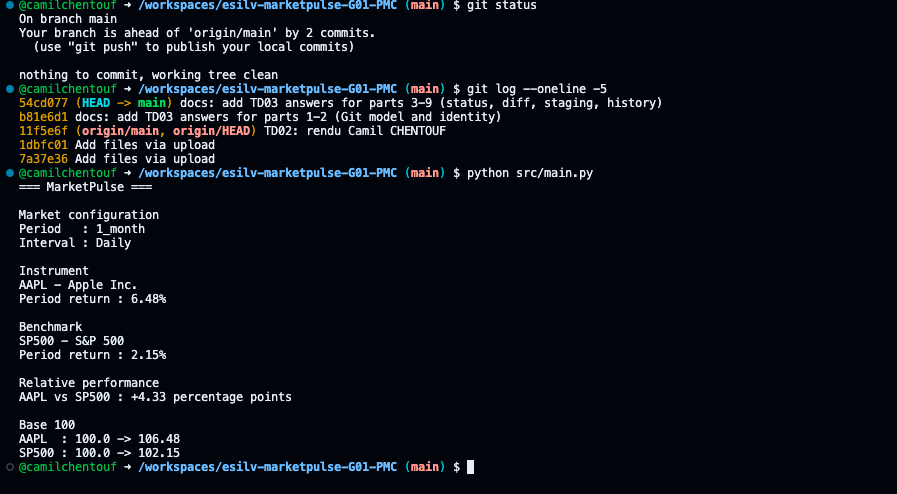

# TD03 – Git Local Workflow

## Partie 1 – Le modèle Git local
- **Working tree** : les fichiers tels que je les modifie dans l'éditeur.
- **Staging area** : les modifications sélectionnées (`git add`) pour le prochain commit.
- **Commit** : un état enregistré du projet (auteur, date, message, identifiant, contenu modifié).
- Sauvegarder un fichier (`Cmd + S`) ne crée pas de commit.

## Partie 2 – Identité Git
- `git config user.name` → `camilchentouf` : identité vérifiée et correcte (email vérifié, non reproduit ici car le repo est public).

## Parties 3-4 – Inspecter avec git status / git diff
- Les modifications Python du TD02 avaient déjà été commitées par l'équipe ; la modification réelle utilisée est ce fichier de réponses.
- `git status` : état du repo. `git status --short` : `??` = fichier non suivi, `M` = fichier suivi modifié, `A` = fichier ajouté au staging.
- `git diff` ne montre que les modifications non stagées des fichiers suivis : il n'affiche rien pour un fichier non suivi.

## Partie 5 – Staging
- `git add <chemin précis>` plutôt que `git add .` pour ne stager que le travail voulu.
- `git diff --staged` : ce qui partira dans le prochain commit. `git diff` : ce qui reste non stagé.

## Partie 6 – Commit
- MarketPulse vérifié avant le commit (`python src/main.py`).
- Commit `b81e6d1` : `docs: add TD03 answers for parts 1-2 (Git model and identity)`.
- Préfixe `docs:` car il s'agit de documentation ; message précise ce qui change (pas de `update`, `final`…).

## Partie 7 – Historique
- `git log --oneline` : commits du plus récent au plus ancien ; `HEAD -> main` = position locale, `origin/main` = dernier état connu de GitHub.
- `git show HEAD` : 1 fichier modifié (`TD03.md`, nouveau), 10 lignes ajoutées, auteur `camilchentouf`.

## Parties 8-9 – Qualité et local vs remote
- Un bon commit est petit, cohérent, compréhensible et explicable.
- Le commit existe d'abord en local ; il n'apparaît sur GitHub qu'après `git push` (TD05).

# Captures

## Fichier non suivi puis stagé (`??` → `A`)

## git diff --staged vs git diff

## Historique local

## Inspection du commit

## Fichier suivi modifié (`M`) et git diff

## Deuxième commit

## Validation finale

